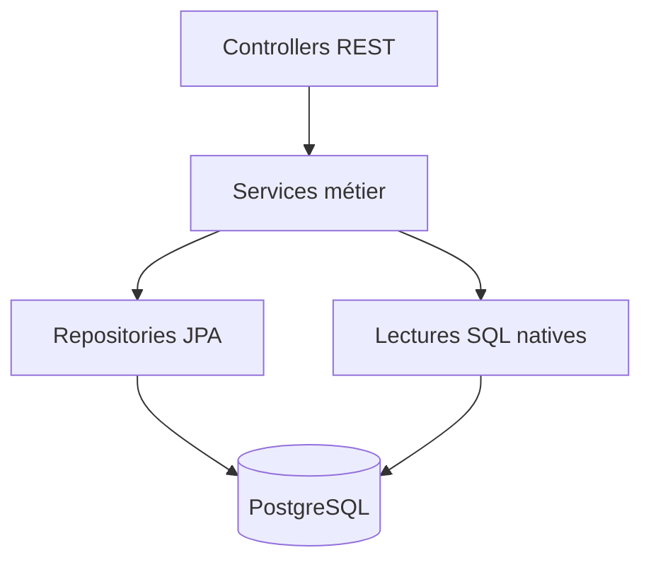
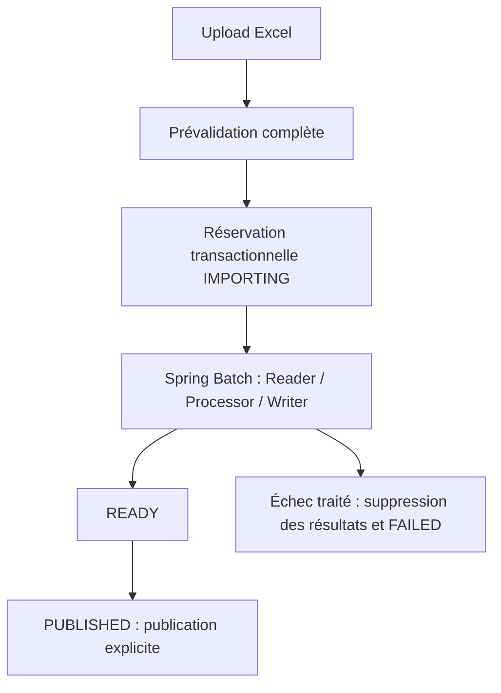

# Natijati MR API

API d’import, de publication et de consultation des résultats des examens nationaux
mauritaniens : BAC, BEPC et C1AS (entrée au collège). Les données sont issues de
fichiers Excel officiels, validés avant leur publication.

Natijati MR est un projet indépendant, sans affiliation revendiquée au ministère.
Le portail public est [natijati-mr.online](https://natijati-mr.online).
Le dépôt compagnon s’appelle **natijati-mr-front**.

## Fonctionnalités

- Import Excel BAC/BEPC/C1AS : formats réels vérifiés, prévalidation complète,
  erreurs techniques sans valeurs nominatives, traitement Spring Batch.
- Sessions distinctes par examen, année et type `NORMAL` / `COMPLEMENTARY`.
- Publication explicite : seules les sessions `PUBLISHED` sont consultables.
- Résultats par numéro de candidat (BAC/BEPC) ou de dossier (C1AS).
- Recherche multicritère paginée, statistiques agrégées, établissements et détails.
- Administration authentifiée, documentation OpenAPI et endpoint de santé.
- Migrations Flyway, contraintes PostgreSQL et tests d’intégration sur base jetable.

## Stack

| Technologie | Rôle |
| --- | --- |
| Java 21, Spring Boot 3.5 | Application monolithique et API REST |
| Spring Data JPA, PostgreSQL | Persistance métier ; SQL natif pour les lectures agrégées |
| Spring Security | Séparation public/admin, HTTP Basic, CORS |
| Spring Batch | Jobs, transactions par chunks, compteurs et statuts |
| Apache POI | Lecture XLS et XLSX, SAX pour XLSX |
| Flyway | Versionnement du schéma ; Hibernate valide les mappings |
| Springdoc OpenAPI | Contrat API et Swagger UI |
| JUnit, MockMvc, Testcontainers | Tests ciblés et intégrations PostgreSQL réelles |
| Maven, Docker | Build et image multi-stage exécutée par un utilisateur non-root |
| Cloud Run, Supabase PostgreSQL | Hébergement applicatif et base de l’architecture de production |

Les versions exactes sont définies dans [pom.xml](pom.xml).

## Architecture



Organisation sous `src/main/java/mr/natijati/results` : `api` pour les endpoints,
`api/publicdata` pour le catalogue et ses lectures, `exam` pour les sessions,
`result` pour les résultats, `importing` pour le pipeline, `config` pour la configuration.

Voir [l’architecture globale et les décisions](docs/ARCHITECTURE.md).

## Lancement local

Prérequis : Java 21, Maven, PostgreSQL de développement. Docker est nécessaire
pour les intégrations Testcontainers, pas pour les tests unitaires.

Le [Compose existant](docker-compose.yml) fournit PostgreSQL 17 sur le port hôte
**5433**. Ses identifiants sont exclusivement des valeurs de développement.
Dans un environnement local dédié :

```sh
docker compose up -d postgres
```

Configurer les variables ci-dessous dans le shell. Les valeurs entre chevrons sont
à remplacer ; aucun secret réel ne doit être versionné.

```sh
export DB_URL='jdbc:postgresql://localhost:5433/<base_de_developpement>'
export DB_USERNAME='<utilisateur_de_developpement>'
export DB_PASSWORD='<mot_de_passe_de_developpement>'
export DB_POOL_SIZE='5'
export ADMIN_USERNAME='<administrateur_local>'
export ADMIN_PASSWORD='<mot_de_passe_admin_local>'
export IMPORT_DIRECTORY='./imports'
mvn spring-boot:run
```

Si Compose est utilisé, reprendre les valeurs de sa configuration locale.
Spring Boot ne charge pas automatiquement un fichier `.env` arbitraire : les
variables doivent être exportées ou injectées par l’outil de lancement.
Le profil `local` est facultatif : il référence les mêmes variables et ajuste des logs.
Commande correspondante : `mvn spring-boot:run -Dspring-boot.run.profiles=local`.

**Démarrage avec écritures :** Flyway applique les migrations et Spring Batch
initialise ses tables. Pointer exclusivement vers une base de développement,
jamais vers une base distante pour une simple démonstration.

Le pool est configuré sous `spring.datasource.hikari`. `DB_POOL_SIZE` configure
réellement `maximumPoolSize` ; le binding est testé sur Hikari/PostgreSQL Testcontainers.
Valeurs par défaut : maximum 5, minimum idle 0, attente de connexion 30 000 ms,
idle timeout 600 000 ms et durée maximale 1 800 000 ms. Les variables optionnelles
`DB_MIN_IDLE`, `DB_CONNECTION_TIMEOUT_MS`, `DB_IDLE_TIMEOUT_MS` et
`DB_MAX_LIFETIME_MS` permettent de les adapter sans nouveau profil.

`ADMIN_PASSWORD` est obligatoire, y compris en local : aucun mot de passe de
secours n'est fourni. Le secret doit être injecté avant le démarrage.

## API

Toutes les consultations de résultats utilisent les sessions publiées.
`sessionType` vaut `NORMAL` lorsqu’il est omis ; `COMPLEMENTARY` sélectionne
explicitement l’autre session, sans fallback vers la session normale.

| Méthode | Endpoint | Usage |
| --- | --- | --- |
| GET | `/api/public/results/bac/{year}/{candidateNumber}` | Résultat BAC |
| GET | `/api/public/results/bepc/{year}/{candidateNumber}` | Résultat BEPC |
| GET | `/api/public/results/c1as/{year}/dossier/{dossierNumber}` | Résultat C1AS |
| GET | `/api/public/catalog/exams` | Examens et sessions disponibles |
| GET | `/api/public/catalog/exams/{examType}/sessions` | Sessions d’un examen |
| GET | `/api/public/catalog/search` | Recherche avec `examType`, `year`, filtres et pagination |
| GET | `/api/public/catalog/statistics/{examType}/{year}` | Statistiques |
| GET | `/api/public/catalog/institutions` | Liste avec `examType`, `year`, pagination |
| GET | `/api/public/catalog/institutions/{id}` | Détail d’un identifiant fourni par la liste |
| POST | `/api/admin/imports` | Multipart `file`, `examType`, `year`, `sessionType` |
| POST | `/api/admin/imports/{sessionId}/publish` | Publication d’une session prête |

Pour la recherche C1AS, le paramètre historique `candidateNumber` transporte le
numéro de dossier. Ne pas le confondre avec le numéro local du candidat C1AS.

Documentation locale : `http://localhost:8080/swagger-ui/index.html`.
JSON OpenAPI : `http://localhost:8080/v3/api-docs`.
Le raccourci `/swagger-ui.html` est également accessible. OpenAPI est public par
choix pour documenter le portfolio/API ; les opérations admin restent authentifiées.

## Import Excel



- Prévalidation avant création/réservation de session : format, headers, champs,
  scores, décisions, formules interdites et doublons.
- XLSX lu avec SAX et spool temporaire ; XLS conserve une lecture en mémoire.
- Chunks de 500 lignes. Un échec traité supprime les résultats partiels de la
  session ; ils ne sont jamais considérés comme publiés.
- Second import refusé pour `IMPORTING`, `READY` et `PUBLISHED`, même si le fichier
  diffère. Une session `FAILED` peut être réimportée intégralement.
- Verrou transactionnel PostgreSQL par triplet ; un import actif par JVM.
- Nettoyage des uploads dans `finally` et des spools à la fermeture du reader.
- Limites : 50 MiB, 100 000 lignes par défaut, une feuille, 64 colonnes.

Le contrat, les headers précis, la politique des erreurs, l’atomicité et les limites
sont décrits dans [docs/IMPORTS.md](docs/IMPORTS.md).

## Tests et qualité

```sh
mvn -B test
mvn -B verify
```

- `test` : tests unitaires/ciblés `*Test`, sans PostgreSQL externe.
- `verify` : ajoute les `*IT` avec Failsafe, Spring Boot, MockMvc, Flyway et PostgreSQL
  Testcontainers. Docker indisponible fait échouer les intégrations ; aucun fallback Supabase.
- Fixtures et fichiers Excel synthétiques ; les connexions des intégrations sont
  fournies par `@ServiceConnection`, indépendamment de `DB_URL`.

Consulter [le guide des tests](src/test/README.md) pour les scénarios et leur isolation.
Les contrôles volume/atomicité sont manuels, hors suite standard :

```sh
mvn -B -Dit.test=ImportVolumeCheck -Dimport.volume.rows=10000 -DargLine=-Xmx640m verify
mvn -B -Dit.test=ImportAtomicityCheck -DargLine=-Xmx640m verify
```

Les résultats Maven constituent la référence courante ; aucun objectif artificiel
à 100 % de couverture n’est revendiqué.

## Sécurité et observabilité

- `/api/public/**` public ; `/api/admin/**` authentifié par HTTP Basic.
  Utiliser HTTPS et un mot de passe administrateur fort hors développement.
- Identifiants applicatifs fournis par variables d’environnement ; encodage du
  mot de passe administrateur en mémoire. Aucun écran admin Angular.
- CORS avec origines explicites ; autres chemins refusés par défaut. CSRF désactivé.
- Validation des uploads, erreurs de ligne masquées et nettoyage ciblé.
- `/actuator/health`, `/actuator/health/liveness` et `/actuator/health/readiness`
  publics, avec le statut et, pour health global, les noms des groupes ; aucun
  détail de datasource, même pour l’admin.
- `/actuator/metrics` et ses sous-ressources accessibles au rôle ADMIN avec HTTP Basic.
  Mesures JVM, HTTP et Hikari disponibles ; ne pas exposer les credentials dans des URL.
- `info`, `env`, `beans`, `configprops`, `heapdump` et autres endpoints non exposés
  et refusés par Security. Aucun wildcard Actuator public.
- Logs d’import avec session, job, statuts, compteurs et durée ; métadonnées Batch
  persistées. Pas de tracing distribué ou de tableau de bord fourni.

Cette configuration ne constitue pas une garantie absolue de sécurité ; la
limitation de débit/brute force et les alertes opérationnelles restent à renforcer.

## Déploiement et limites

Le [Dockerfile](Dockerfile) construit le JAR puis utilise une JRE 21 non-root.
Il saute les tests : exécuter `mvn verify` séparément avant toute livraison.
L’architecture déclarée utilise Artifact Registry, Cloud Run, Supabase PostgreSQL
et Secret Manager pour injecter les secrets ; elle n’est pas provisionnée par ce dépôt.
`IMPORT_DIRECTORY=/tmp/imports` est prévu sur Cloud Run.

- Import encore synchrone HTTP ; timeout et arrêt d’instance restent des risques.
- Après arrêt brutal, une session peut rester `IMPORTING` avec des chunks partiels
  non publics. Récupération opérateur contrôlée, pas de redémarrage automatique.
- Volumes >100k, gros XLS, concurrence sous charge et latence Supabase non qualifiés.
- Les formats officiels annuels BAC/BEPC/C1AS doivent être vérifiés avant chaque campagne.
- Index PostgreSQL présents pour identifiants et recherches ; aucune garantie de
  capacité nationale issue des seuls tests locaux.
- CI GitHub Actions et déploiement manuel préparés ; activation WIF/IAM à réaliser.
- Pas de migration vers Cloud Run Jobs dans cette version.

## Santé et exploitation Cloud Run

Liveness vérifie l’état de disponibilité interne de l’application, sans PostgreSQL.
Readiness combine `readinessState` et `db` : un contrôle DB en échec renvoie 503,
sans erreur SQL détaillée. Ce choix reflète la dépendance des résultats à PostgreSQL ;
un échec partagé de la base peut rendre toutes les instances non prêtes.

Ces endpoints ne configurent **aucune sonde Cloud Run automatiquement**. La startup
probe vérifie le démarrage, la liveness probe peut entraîner un redémarrage,
et une readiness probe configurée contrôle l’admission du trafic. Pour une future
configuration : ne jamais utiliser le health global dépendant de la DB comme liveness.
Utiliser des seuils de plusieurs échecs/succès et des timeouts adaptés, pas un
redémarrage sur une seule latence réseau. Une startup probe pointant vers readiness
peut attendre DB et initialisation, avec une fenêtre de démarrage suffisante.

Aucune fréquence, seuil ou sonde distante n’est modifié ici. Le contrôle DB peut
attendre une connexion du pool ; `connectionTimeout` n’est pas un timeout global
SQL/réseau. Mesurer sa latence en recette avant de choisir les timeouts des sondes.

Avec les paramètres annoncés (pool 5, maximum 5 instances), compter environ
**25 connexions clientes JDBC vers le pooler** en régime stable, hors migrations,
autres clients et chevauchements de révisions. Une concurrence HTTP de 40 par
instance n’implique pas 40 connexions SQL. En mode transaction, le pooler peut
multiplexer ces clients sur moins de connexions serveur PostgreSQL ; en mode session,
le comportement diffère. Vérifier le mode et les limites réelles Supabase avant réglage.
Pool 5 reste un point de départ prudent pour 1 CPU, à confirmer avec les métriques
`hikaricp.connections.active`, `idle`, `pending` et les temps d’acquisition.

Les logs restent au niveau INFO par défaut, sans debug Security/SQL ajouté. Les logs
d’import conservent les compteurs P2-E ; le log nominatif BAC a été retiré. Les erreurs
standard Spring Boot n’exposent ni message interne ni stacktrace. Les erreurs métier
contrôlées gardent leurs messages utiles. Pas de Prometheus ni de nouvelle stack de logs.

Références : [health groups Spring Boot 3.5](https://docs.spring.io/spring-boot/3.5/reference/actuator/endpoints.html),
[sondes Cloud Run](https://docs.cloud.google.com/run/docs/configuring/healthchecks),
[pooling Supabase](https://supabase.com/docs/guides/database/connecting-to-postgres/pooling-and-limits).

## Contribution et licence

Projet personnel : privilégier des changements ciblés, des fixtures synthétiques
et la validation `mvn verify`. Ne pas versionner de secrets ni de fichiers candidats.
Aucune licence du projet n’est définie actuellement ; une licence reste à choisir
par son auteur. Les dépendances conservent leurs propres licences.

## CI/CD GitHub Actions

PR et push main exécutent tests et build Docker. La production passe par un workflow
manuel séparé, WIF sans clé JSON, Environment production et image identifiée par SHA/digest.
Voir [configuration CI/CD et prérequis manuels](docs/CI_CD.md). Aucun déploiement
n’est déclenché par un simple push main.
