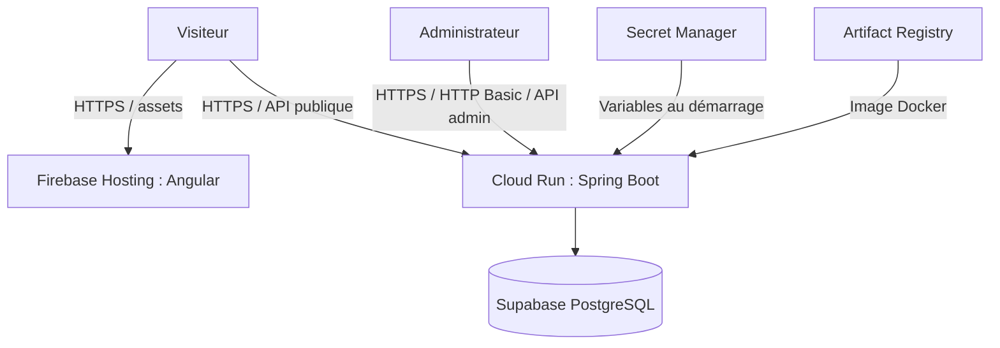
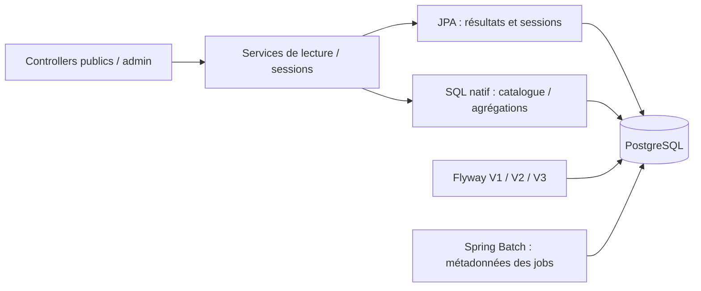
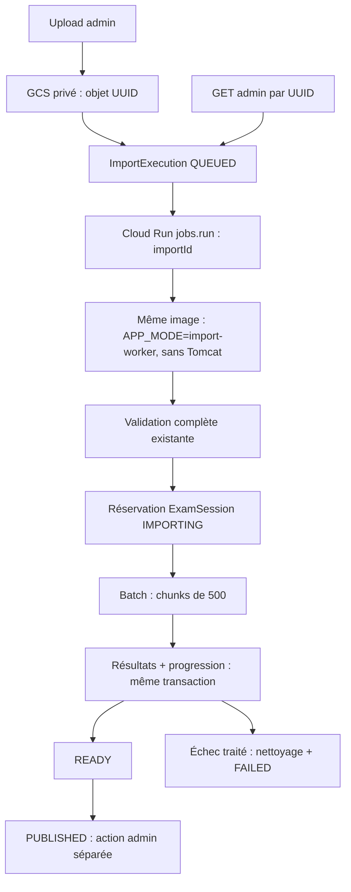

# Architecture de Natijati MR

Document principal commun au backend **natijati-mr-api** et au frontend
**natijati-mr-front**. Il décrit le code présent et l’architecture de déploiement
annoncée, sans prétendre vérifier la configuration des services cloud à distance.

## Contexte et frontières

Natijati MR facilite la consultation des résultats BAC, BEPC et C1AS issus de
fichiers officiels annuels. C’est une plateforme indépendante. L’administrateur
importe et publie ; les visiteurs consultent uniquement les sessions publiées.

Deux dépôts Git autonomes, un monolithe Spring Boot et une SPA Angular. Le dossier
workspace n’est pas un troisième dépôt ; chaque README explique son propre
lancement et nomme le dépôt compagnon. Aucun document de credentials local ne
fait partie de la documentation partageable.

Le frontend appelle directement Cloud Run. Firebase ne relaie pas les requêtes API
comme le fait le proxy de développement. Il n’y a ni microservices, ni bus de
messages, ni infrastructure as code. Les workflows GitHub Actions séparent CI et
déploiement manuel ; voir [CI/CD](CI_CD.md) pour les prérequis GitHub/WIF.

## Frontend

`core` contient les modèles et services HTTP/i18n/métadonnées ; `features` contient
les pages ; `shared/components` contient le header et le statut PWA. Les routes
utilisent `loadComponent`. Signals gère l’état local ; RxJS coordonne les requêtes
et les changements de paramètres, notamment l’annulation des lectures de résultats.

I18n repose sur des dictionnaires FR/AR, pas sur la compilation Angular i18n.
La langue pilote `lang`, `dir`, les polices et la direction CDK des overlays.
Polices Fontsource auto-hébergées et versions verrouillées dans npm.

Le menu mobile Material, les formulaires, la pagination et les messages de statut
sont accessibles au clavier. Les validations existantes ne remplacent pas une
certification WCAG ni une recette avec technologies d’assistance.

## Backend et données

Le schéma métier est défini dans
[V1__create_exam_tables.sql](../src/main/resources/db/migration/V1__create_exam_tables.sql).
Une session possède un triplet unique `(exam_type, exam_year, session_type)`.
Les tables BAC, BEPC et C1AS restent distinctes car leurs formats et identifiants
ne sont pas identiques. Leurs clés étrangères référencent `exam_session`.

Contraintes : `(session, candidate_number)` unique pour BAC/BEPC ;
`(session, dossier_number)` unique pour C1AS. Le numéro candidat C1AS n’est pas
l’identifiant public principal. Les établissements et statistiques sont dérivés
des résultats, pas d’un service ou d’un référentiel établissement séparé.
Des index soutiennent les recherches d’identifiants ; les agrégations/textes
restent à mesurer en charge. Aucun cache distribué n’est introduit.

Hibernate valide le schéma, Flyway le fait évoluer. V1 ayant été utilisée, toute
évolution doit ajouter une migration incrémentale ; ne pas réécrire V1. Les tables
Spring Batch sont initialisées séparément par la configuration Batch.

## Import et publication

Le POST renvoie 202 après stockage durable, création DB et dispatch, sans attendre
le preflight. Les validations métier et la précision V2 sont conservées. V3 crée
une tentative technique séparée de la session métier. Les chunks commitent
réellement ; leur progression est atomique avec les résultats, le nettoyage sur
échec est compensatoire. Aucune donnée intermédiaire n’est publique.

Un verrou worker PostgreSQL de session (connexion directe ou pooler SESSION)
et un contrôle de tentative verrouillé par chunk empêchent deux workers de traiter
le même import. Après interruption : nettoyage puis preflight et import depuis
zéro avec une nouvelle JobInstance ; `preventRestart()` reste actif.
Les sources sont supprimées après état terminal, avec lifecycle de sécurité.
Publication explicite et refus de remplacer READY/PUBLISHED inchangés.

Voir [ASYNC_IMPORTS.md](ASYNC_IMPORTS.md) pour le contrat admin, la récupération et
les commandes GCP préparées, et [IMPORTS.md](IMPORTS.md) pour les règles Excel.

## Sécurité et confidentialité

- Chaîne Spring Security : endpoints publics distincts, admin authentifié par
  HTTP Basic, mot de passe encodé en mémoire ; pas de gestion multi-utilisateurs.
- HTTPS requis pour l’administration distante. CSRF désactivé et CORS sur liste
  d’origines explicites : ne pas présenter cela comme une protection brute force.
- Secrets runtime injectés hors sources ; les valeurs Compose sont uniquement de
  développement et ne doivent pas être réutilisées en production.
- Erreurs d’import avec champ/ligne et valeurs masquées ; dates et lieux de naissance
  non stockés par le modèle de résultat actuel.
- Angular SW : `dataGroups: []`. Le worker personnalisé force le réseau sans cache
  pour résultats/recherches et purge les anciennes structures de cache reconnues.
- Titres et métadonnées sans nom ni identifiant personnel ; noindex des routes
  résultat/recherche, sitemap limité aux pages publiques stables.

Une API publique reste consultable et peut être extraite par des tiers. Ni CORS,
ni noindex, ni la suppression du cache PWA ne constituent un contrôle d’accès aux
résultats publiés. La validation upload ne remplace pas une politique complète
anti-abus. Les secrets, quotas et accès cloud effectifs restent de l’exploitation.

## Tests et éléments de preuve

- Backend : tests ciblés puis intégrations Spring Boot/MockMvc/PostgreSQL
  Testcontainers. Flyway, JPA, SQL, Security, sessions et imports réellement exercés.
- Les intégrations forcent leur datasource temporaire ; aucune utilisation de
  DB_URL de production. `ImportIT` vérifie les commits/nettoyages sans transaction
  englobante de test, contrairement aux fixtures transactionnelles de `BackendIT`.
- Frontend : TestBed/Jasmine dans ChromeHeadless, tests métier Node et contrôles PWA.
  Pas de suite E2E installée. API mockée dans les tests frontend.
- Mesures historiques P2-E, synthétiques locales : 65k lignes BAC × 18 colonnes,
  environ 19,8 s d’import et 181 MiB de somme des pics heap des pools. Ce n’est ni
  la RSS du conteneur, ni un benchmark réseau Supabase/Cloud Run 1 CPU.
- Le contrôle d’échec après 40k écritures sur 65k confirme FAILED, zéro résultat
  conservé après nettoyage, publication refusée et nouvelle tentative possible.

Les commandes actuelles figurent dans les guides
[backend](../src/test/README.md) et `tests/README.md` du dépôt frontend.

## Exploitation et limites

Cloud Run reçoit l’image construite par Docker via Artifact Registry ; Secret
Manager fournit les secrets selon la configuration de déploiement. Rien dans ces
dépôts ne provisionne ni n’atteste les droits IAM effectifs.

L’import s’exécute dans un Cloud Run Job à configurer ultérieurement, avec le même
digest d’image que l’API. Proposition initiale : 1 tâche, 1 CPU, 2 GiB, 7 200 s,
2 retries. `/tmp/imports` et les spools consomment aussi la mémoire du Job. Une
coupure laisse un état actif récupérable par relance du même UUID, avec nettoyage
avant reprise. Il n’y a pas de reconciler automatique dans cette phase.
Le timeout HTTP de 3 600 s pourra être abaissé après recette de l’async.

À suivre avant une exploitation à forte charge : budget de connexions du pooler, latence des inserts JPA IDENTITY,
quotas et limites HTTP, supervision et récupération opérateur. Le binding Hikari est vérifié sur la datasource réelle (`DB_POOL_SIZE` → maximumPoolSize).
Health/liveness/readiness sont publics sans détails ; metrics est réservé à ADMIN,
info et les autres endpoints sensibles ne sont pas exposés. Readiness inclut la DB,
liveness uniquement l’état interne. Les sondes Cloud Run doivent être configurées
séparément, avec des seuils tolérant les incidents transitoires : aucune modification
d’infrastructure n’est réalisée par cette configuration applicative.

`ADMIN_PASSWORD` est requis sans valeur de secours. Swagger reste public, y compris
son raccourci, mais ne dispense pas de l’authentification des opérations admin.
La politique et les paramètres de pool sont détaillés dans le [README](../README.md).

## Décisions d’architecture — fiches courtes

### D1 — Conserver le monolithe et la SPA

**Contexte :** domaine limité, besoin de transactions cohérentes et maintenance personnelle.
**Décision :** Spring Boot modulaire par responsabilités, Angular séparé ; pas de microservices.
**Conséquence :** une image commune ; l’import utilise désormais un processus Job distinct.
**Réexamen :** uniquement si des contraintes mesurées imposent d’isoler l’exécution des imports.

### D2 — Ne pas cacher les résultats nominatifs dans la PWA

**Contexte :** terminaux partagés, données personnelles et risque d’anciens résultats servis hors ligne.
**Décision :** cache statique uniquement, purge ciblée de l’ancien cache, réseau sans fallback pour les résultats.
**Conséquence :** consultation nominative impossible hors ligne ; shell toujours utilisable.

### D3 — Lire XLSX en SAX et recommencer les imports échoués

**Contexte :** le workbook complet échouait à 65k lignes avec une heap de 640 MiB ;
une reprise sur fichier supprimé et résultats nettoyés serait ambiguë.
**Décision :** SAX + spool, prévalidation complète, chunks et nettoyage ; restart Batch interdit.
**Conséquence :** deux lectures et du stockage temporaire ; mémoire réduite, retry explicite et complet.

### D4 — Héberger statiquement le frontend, sans SSR actuellement

**Contexte :** Firebase distribue une SPA/PWA ; les résultats dynamiques ne doivent pas être promus dans les moteurs.
**Décision :** conserver Firebase + Cloud Run ; métadonnées génériques initiales et titres côté client.
**Conséquence :** indexation/partage SPA limités. Évaluer plus tard le pré-rendu des seules pages éditoriales.

Ces fiches explicitent les choix actuels ; elles ne prétendent pas reconstituer
l’historique complet des décisions de déploiement.

### D5 — Import durable via GCS privé et Cloud Run Jobs

**Contexte :** arrêt réel de l’instance API après 47 500 / 121 140 lignes C1AS,
avec session IMPORTING et Batch STARTED.
**Décision :** POST 202, source durable privée, ImportExecution V3 et worker sans HTTP.
**Conséquence :** progression persistée et reprise complète testée après kill ; IAM,
bucket et Job restent à provisionner manuellement. Pas de dépendance à `@Async`.
