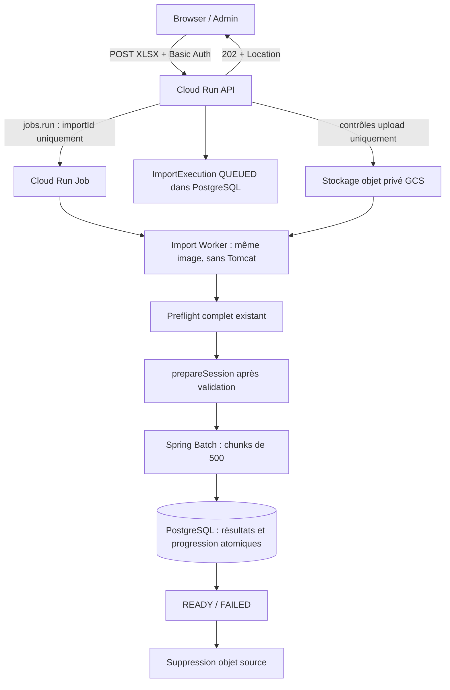
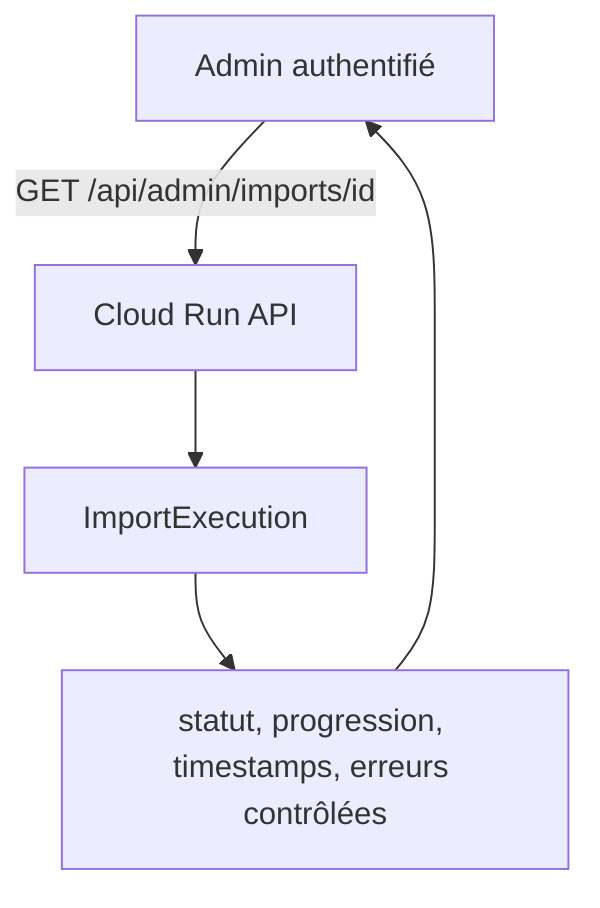

# P4-C — Imports asynchrones et progression

## Situation avant

Le POST admin réalisait upload, preflight, réservation et Batch avant de répondre.
Lors de l’incident C1AS, **47 500 / 121 140** lignes étaient commitées lorsque
l’instance Cloud Run a été arrêtée après le timeout HTTP. La session était encore
`IMPORTING` et le StepExecution `STARTED`. Le timeout porté à 3 600 s a permis les
imports officiels ; il ne rendait pas leur exécution durable.

Ce document décrit le code P4-C et des opérations **à effectuer ultérieurement**.
Aucune commande GCP de ce document n’a été exécutée pendant P4-C. Aucun accès à
Supabase, import officiel, publication officielle, commit, push ou déploiement.

## Architecture retenue





Le moteur n’est pas dupliqué : mêmes readers, processor, writer, preflight,
`ExamSessionService` et job non redémarrable. L’API ne lit aucune ligne métier Excel.
Elle copie le multipart dans un staging local borné, vérifie extension, taille,
magic bytes et limites ZIP existantes, puis transfère l’objet privé durable.
Le staging local est supprimé après la soumission. La lecture XML/SAX complète
et toutes les règles P2-E restent dans le worker.

## Pourquoi @Async n’est pas utilisé

Aucun `@Async`, thread applicatif, executor ou queue mémoire : le Job est un
processus Cloud Run indépendant de l’instance et de la requête HTTP.

## ImportExecution et migration V3

Agrégat Java immutable persisté avec `JdbcTemplate`, distinct de `ExamSession`.
Migration exacte : [V3__async_import_execution.sql](../src/main/resources/db/migration/V3__async_import_execution.sql).
V1 et V2 sont inchangées. Les tables Batch existantes sont conservées.

| Colonne | Type PostgreSQL | Nullabilité / défaut |
| --- | --- | --- |
| id | uuid | PK, requis |
| exam_type | varchar(10) | requis, BAC / BEPC / C1AS |
| exam_year | integer | requis, 1900–2100 |
| session_type | varchar(20) | requis, NORMAL / COMPLEMENTARY |
| status | varchar(20) | requis, six statuts ci-dessous |
| object_key | varchar(100) | requis, unique |
| expected_rows | bigint | nullable, > 0 si renseigné |
| read_rows | bigint | requis, 0, >= 0 |
| written_rows | bigint | requis, 0, >= 0 |
| rejected_rows | bigint | requis, 0, >= 0 |
| ignored_columns | integer | requis, 0 |
| session_id | bigint | nullable, FK exam_session(id) |
| batch_job_execution_id | bigint | nullable |
| cloud_run_execution_name | varchar(512) | nullable |
| dispatch_operation_name | varchar(512) | nullable |
| attempt_count | integer | requis, 0 |
| created_at | timestamptz | requis, now() |
| started_at | timestamptz | nullable |
| updated_at | timestamptz | requis, now() |
| finished_at | timestamptz | nullable |
| duration_ms | bigint | nullable |
| error_code | varchar(64) | nullable |
| error_summary | varchar(256) | nullable, messages constants |
| source_deleted_at | timestamptz | nullable |

Index unique partiel sur `(exam_type, exam_year, session_type)` pour les états
actifs : empêche deux soumissions logiques concurrentes dès QUEUED.
Index sur `created_at DESC` pour les imports récents. La réservation utilise aussi
le même verrou transactionnel par triplet que `ExamSessionService` et refuse les
sessions déjà IMPORTING, READY ou PUBLISHED.

Aucun nom de fichier utilisateur, nom candidat, identifiant candidat, cellule ou
stack trace dans cette table. `dispatch_operation_name` est la réponse de
`jobs.run` ; ce n’est **pas** le nom d’exécution. Le worker enregistre séparément
`CLOUD_RUN_EXECUTION`, variable fournie par Cloud Run.

## Cycle de vie et erreurs

`QUEUED → STARTING → VALIDATING → IMPORTING → READY`.

- `STARTING` : claim et incrément de tentative après acquisition du verrou worker.
- `VALIDATING` : download et preflight, sans création d’une nouvelle session métier.
- `IMPORTING` : session réservée, Batch synchrone à l’intérieur du processus worker.
- `READY` : nombre attendu, compteurs committés et nombre métier concordants ;
  session et exécution passent à READY dans **la même transaction**.
- `FAILED` : preflight invalide (`VALIDATION_FAILED`), source absente
  (`SOURCE_MISSING`) ou erreur Batch traitée (`BATCH_FAILED`). Nettoyage des
  résultats et statut FAILED atomiques avant suppression de la source.
- Une erreur d’infrastructure empêchant la finalisation laisse l’état actif,
  conserve la source et renseigne `RECOVERY_REQUIRED` si PostgreSQL reste joignable.
  Après SIGKILL, aucun code ne peut écrire : l’état et `updated_at` permettent
  le diagnostic et une relance du même identifiant.

`started_at` désigne la première tentative ; `duration_ms` mesure jusqu’à la
finalisation, reprises comprises. `attempt_count` compte les claims effectifs.
Les compteurs remis à zéro au début d’une nouvelle tentative reflètent ses commits.
Après FAILED traité, ils gardent le nombre commité avant nettoyage pour diagnostic ;
les résultats conservés dans la session valent zéro. Aucune ligne invalide n’est
ignorée : `rejected_rows` reste 0 (pas de politique de skip). Les erreurs bloquantes
sont représentées par `errors`, pas par un compteur de rejets inventé.

Le GET est une projection de `ImportExecution`, sans dépendance au schéma Batch.
`updated_at` est une activité observable, pas une preuve d’abandon : le preflight
ou un appel réseau peuvent être longs. Ne jamais libérer une réservation sur la
seule base de son âge.

## Contrat HTTP admin et migration du client

**Rupture explicite** : POST renvoie désormais **202**, plus un résultat Batch final.
La recherche dans `natijati-mr-front` n’a trouvé aucun consommateur de
`/api/admin/imports` ou `ImportJobResponse`. Les tests historiques du moteur gardent
un harnais synchrone exclusivement de test ; `AsyncImportIT` exerce le vrai contrat.

| Méthode | Chemin | Contrat |
| --- | --- | --- |
| POST multipart | /api/admin/imports | file, examType, year, sessionType ; 202 + Location |
| GET | /api/admin/imports/{importId} | état/progression ; UUID ; 404 si absent |
| GET | /api/admin/imports?limit=20 | derniers imports, limite 1–100 |
| POST | /api/admin/imports/{sessionId}/publish | **inchangé**, sessionId numérique |

Tous sont protégés par HTTP Basic et rôle ADMIN. Les routes publiques et leur
contrat sont inchangés. Aucune publication automatique, URL signée ou route
servant le fichier source. L’admin attend READY, contrôle, puis publie explicitement.

Exemple conforme au DTO réel, basé sur le scénario synthétique d’interruption :

```json
{
  "importId": "d9a7fcbf-c624-4cd3-8d99-4806ba06d937",
  "examType": "BAC",
  "year": 2026,
  "sessionType": "NORMAL",
  "status": "IMPORTING",
  "expectedRows": 5000,
  "readRows": 2000,
  "writtenRows": 2000,
  "rejectedRows": 0,
  "progressPercent": 40.00,
  "sessionId": 1,
  "batchJobExecutionId": 1,
  "attemptCount": 1,
  "createdAt": "2026-10-24T11:00:00Z",
  "startedAt": "2026-10-24T11:00:01Z",
  "updatedAt": "2026-10-24T11:00:05Z",
  "finishedAt": null,
  "durationMs": null,
  "errors": []
}
```

Les identifiants/timestamps ci-dessus sont illustratifs. La réponse initiale a
`status=QUEUED`, `expectedRows=null`, `sessionId=null`, compteurs 0 et progression
null (sauf si le worker a déjà avancé entre dispatch et lecture). Calcul décimal :
`writtenRows * 100 / expectedRows`, arrondi HALF_UP à deux décimales ; null si total
inconnu. 47 500 / 121 140 donne 39,21 %.

Le client conserve l’importId et poll le GET, par exemple toutes les 2–5 secondes.
Un succès HTTP 202 n’est pas un succès d’import. Un mauvais classeur métier donne
202 puis FAILED sans session. Extension, contenu vide, taille ou magic invalides
restent des refus immédiats ; stockage indisponible donne 503 masqué.

## Progression et idempotence

Une seule mise à jour de compteurs par chunk de 500, dans la transaction JPA/JDBC
qui écrit ses résultats. Le compteur devient visible **après le commit**, même si
le processus meurt avant `afterChunk`. Un rollback annule aussi la progression.
Pas d’écriture par ligne ; environ 243 mises à jour pour 121 140 lignes.

Un verrou PostgreSQL **de session**, conservé sur une connexion dédiée empruntée
au pool, limite initialement à un seul worker actif dans toute la base. Aucun
Semaphore JVM. Un second worker reçoit un échec temporaire et ne claim pas.
Le contrôle de tentative avec verrou de ligne `FOR UPDATE` précède chaque chunk,
chaque modification de session et chaque finalisation : un ancien worker dont la
connexion de verrou a été perdue ne peut plus écrire après un nouveau claim du
même import. Le nettoyage attend les éventuelles transactions de chunk en cours.

**Précondition d’exploitation : connexion PostgreSQL directe ou pooler en mode
SESSION pour le Job. Ne pas utiliser un pooler en mode TRANSACTION** avec ce
verrou de session. Prévoir au moins 3 connexions, proposition initiale 5. L’API
peut conserver son mode de connexion actuel ; le Job reçoit son propre secret URL.

Après interruption : acquisition du verrou, claim incrémenté, suppression des
résultats partiels de la session, marquage ABANDONED des anciennes exécutions Batch
actives, compteurs à zéro, preflight complet et nouvelle JobInstance. Aucune reprise
au dernier chunk. L’option `preventRestart()` existante reste active.
READY est idempotent, exit 0 ; FAILED traité est terminal, exit 1 sans réimport.
Le worker réessaie aussi le nettoyage d’un objet terminal si nécessaire.

Pas d’endpoint `/retry` en P4-C : après FAILED traité la source est supprimée,
il faut corriger puis refaire l’upload. La relance opérateur du **même importId**
sert uniquement aux imports actifs interrompus ou au nettoyage terminal. Ne pas
modifier manuellement les statuts ni réinitialiser les tables Batch pour redémarrer.

## Cloud Run Job

`APP_MODE=import-worker` sélectionne `WebApplicationType.NONE` avant le démarrage
Spring. `IMPORT_ID` est un UUID obligatoire ; le processus traite exactement cette
exécution puis ferme le contexte. Exit 0 pour READY (y compris doublon), exit 1
pour FAILED, conflit de worker ou interruption technique. Le même Dockerfile et
le même digest backend sont utilisés. Aucun secret admin requis en mode non web.
Les secrets DB sont propres au Job ; le dispatch n’en transporte aucun.

## Dispatch incertain et récupération contrôlée

Le stockage, PostgreSQL et l’API Cloud Run ne partagent pas de transaction.
Un timeout de dispatch peut survenir alors que Cloud Run a déjà accepté le Job.
La réponse conserve donc l’importId, QUEUED et `DISPATCH_UNCONFIRMED` si le worker
n’a pas déjà claim. La source et la réservation sont conservées. Aucun second Job
n’est lancé automatiquement par le POST et aucun fichier potentiellement utilisé
n’est supprimé. Un redrive du même importId est sûr grâce au verrou et au fencing.

Une panne entre la création DB et le dispatch laisse QUEUED. Une panne après le
stockage avant la création DB laisse un objet orphelin. Le premier cas nécessite
une relance contrôlée ; le second est couvert par la lifecycle. Il n’y a pas de
scheduler/reconciler automatique dans cette phase.

Procédure opérateur :

1. Lire GET admin (ou la requête technique ci-dessous), noter statut, updatedAt,
   importId, batchJobExecutionId et nom d’exécution dans les logs.
2. Vérifier l’exécution Cloud Run. Si elle est encore active, attendre ; ne pas
   reprendre une importation simplement parce que le pourcentage est stable.
3. Si l’exécution est arrêtée/échouée ou le dispatch absent, relancer le Job avec
   le même importId via la commande ci-dessous. Le verrou refuse un chevauchement.
4. Confirmer compteurs remis à zéro puis READY exact et objet supprimé.
5. Si la lifecycle a supprimé la source, le worker clôt FAILED SOURCE_MISSING et
   libère la réservation ; refaire un upload. Pas de conservation indéfinie.

Requête de diagnostic à utiliser uniquement dans un environnement autorisé :

```sql
SELECT id, exam_type, exam_year, session_type, status, expected_rows,
       read_rows, written_rows, attempt_count, updated_at, error_code,
       batch_job_execution_id, cloud_run_execution_name
FROM import_execution
WHERE status IN ('QUEUED','STARTING','VALIDATING','IMPORTING')
  AND updated_at < now() - interval '2 hours'
ORDER BY created_at;
```

L’âge est un signal d’examen, **pas** une autorisation de supprimer des données.
Surveiller aussi les états terminaux où `source_deleted_at IS NULL` et les logs
`import_source_cleanup_pending`. Relancer le même identifiant pour retenter la
suppression ; la lifecycle protège également ce cas.

## Stockage et sécurité

`imports/{UUID}/source.xlsx` (ou `.xls` pour compatibilité existante). Aucun nom
fourni par l’utilisateur. `ImportObjectStorage` propose store/download/delete/exists.
GCS utilise les API REST officielles ; les tests utilisent un filesystem temporaire.
L’upload GCS utilise `ifGenerationMatch=0` pour interdire l’écrasement.
Download en streaming borné à 50 MiB ; upload en streaming depuis le staging.
Les requêtes cloud ont des délais bornés, sans retry implicite du dispatch.

Bucket privé avec uniform bucket-level access et public access prevention.
Lifecycle à 3 jours pour `imports/`, sans versioning ni rétention verrouillée ;
soft delete désactivé pour ne pas conserver les données après suppression.
La suppression lifecycle est asynchrone, pas une garantie d’effacement à l’heure
exacte. READY/FAILED traité essaie immédiatement de supprimer la source.

Logs applicatifs avec identifiants techniques et compteurs uniquement. Aucun
Throwable cloud/SQL n’est transmis au logger. Les dumps Batch et JDBC Hibernate
sont désactivés dans la configuration, car les diagnostics SQL peuvent inclure
des valeurs de ligne. Ne pas activer SQL bind/TRACE en production. Les métadonnées
Batch internes existantes ne sont jamais exposées via l’API.

Dépendance ajoutée : `google-auth-library-oauth2-http:1.43.0`, bibliothèque officielle
ADC. HTTP JDK et Jackson déjà présents servent aux deux API REST : pas de SDK GCS
et Run complets avec deux graphes de dépendances. Aucune clé JSON, aucun appel
`gcloud` depuis Java. ADC est résolu uniquement lors d’un appel cloud effectif.

## IAM requis

| Identité runtime | Portée | Permissions |
| --- | --- | --- |
| API | bucket dédié | storage.objects.create, get, delete |
| API | Job d’import seulement | run.jobs.run, run.jobs.runWithOverrides |
| Job | bucket dédié | storage.objects.get, delete |
| Job | trois secrets DB précis | secretmanager.versions.access via secretAccessor |
| Job | PostgreSQL | droits SQL et connectivité existants à configurer indépendamment |

Aucun rôle Owner/Editor, aucune clé JSON, aucun accès au secret ADMIN_PASSWORD
pour le Job. Les rôles custom et bindings exacts sont préparés ci-dessous.

## Infrastructure manuelle restante — NE PAS EXÉCUTER pendant P4-C

Commandes à adapter et faire revoir avant une activation ultérieure. Elles sont
fournies pour exécution depuis la racine backend ; les valeurs entre chevrons
sont des placeholders. Utiliser un projet de recette isolé pour les smoke tests.
Ne jamais copier des secrets dans les arguments ; référencer Secret Manager.

```bash
PROJECT_ID='<projet>'
REGION='europe-west1'
BUCKET='<bucket-unique-imports-prive>'
API_SERVICE='<service-api>'
API_SA='<identite-api-existante>@<projet>.iam.gserviceaccount.com'
JOB='natijati-import-worker'
JOB_SA="natijati-import-worker@${PROJECT_ID}.iam.gserviceaccount.com"
IMAGE='<region>-docker.pkg.dev/<projet>/<repo>/<image>@sha256:<digest>'
DB_URL_SECRET='<secret-url-postgresql-directe-ou-session>'
DB_USERNAME_SECRET='<secret-db-username>'
DB_PASSWORD_SECRET='<secret-db-password>'
# Versions numériques vérifiées, pas latest pour un déploiement reproductible.
DB_URL_VERSION='<version>'
DB_USERNAME_VERSION='<version>'
DB_PASSWORD_VERSION='<version>'

# APIs, identité Job ; aucune clé de service account.
gcloud services enable run.googleapis.com storage.googleapis.com secretmanager.googleapis.com --project="$PROJECT_ID"
gcloud iam service-accounts create natijati-import-worker --project="$PROJECT_ID" --display-name='Natijati import worker'

# Bucket dédié sans accès public ni conservation cachée après suppression.
gcloud storage buckets create "gs://$BUCKET" --project="$PROJECT_ID" --location="$REGION" \
  --uniform-bucket-level-access --public-access-prevention --soft-delete-duration=0 \
  --lifecycle-file=docs/infra/imports-lifecycle.json

# Rôles minimaux : ni liste de buckets/objets, ni Owner/Editor.
gcloud iam roles create natijatiImportApiObjects --project="$PROJECT_ID" --file=docs/infra/import-api-storage-role.yaml
gcloud iam roles create natijatiImportWorkerObjects --project="$PROJECT_ID" --file=docs/infra/import-worker-storage-role.yaml
gcloud iam roles create natijatiImportDispatch --project="$PROJECT_ID" --file=docs/infra/import-dispatch-role.yaml

gcloud storage buckets add-iam-policy-binding "gs://$BUCKET" \
  --member="serviceAccount:$API_SA" --role="projects/$PROJECT_ID/roles/natijatiImportApiObjects"
gcloud storage buckets add-iam-policy-binding "gs://$BUCKET" \
  --member="serviceAccount:$JOB_SA" --role="projects/$PROJECT_ID/roles/natijatiImportWorkerObjects"

# Lecture des trois secrets DB uniquement ; pas de secret ADMIN_PASSWORD pour le Job.
gcloud secrets add-iam-policy-binding "$DB_URL_SECRET" --project="$PROJECT_ID" \
  --member="serviceAccount:$JOB_SA" --role=roles/secretmanager.secretAccessor
gcloud secrets add-iam-policy-binding "$DB_USERNAME_SECRET" --project="$PROJECT_ID" \
  --member="serviceAccount:$JOB_SA" --role=roles/secretmanager.secretAccessor
gcloud secrets add-iam-policy-binding "$DB_PASSWORD_SECRET" --project="$PROJECT_ID" \
  --member="serviceAccount:$JOB_SA" --role=roles/secretmanager.secretAccessor

# Même digest que l’API, sans --execute-now. Une tâche ; 2 retries maximum.
gcloud run jobs create "$JOB" --project="$PROJECT_ID" --region="$REGION" \
  --image="$IMAGE" --service-account="$JOB_SA" --tasks=1 --parallelism=1 \
  --task-timeout=7200s --max-retries=2 --cpu=1 --memory=2Gi \
  --set-env-vars="APP_MODE=import-worker,IMPORT_PROVIDER=gcp,IMPORT_BUCKET=$BUCKET,IMPORT_DIRECTORY=/tmp/imports,APP_IMPORT_MAX_ROWS=150000,DB_POOL_SIZE=5,DB_MIN_IDLE=0,JAVA_TOOL_OPTIONS=-Xmx768m" \
  --set-secrets="DB_URL=$DB_URL_SECRET:$DB_URL_VERSION,DB_USERNAME=$DB_USERNAME_SECRET:$DB_USERNAME_VERSION,DB_PASSWORD=$DB_PASSWORD_SECRET:$DB_PASSWORD_VERSION"

gcloud run jobs add-iam-policy-binding "$JOB" --project="$PROJECT_ID" --region="$REGION" \
  --member="serviceAccount:$API_SA" --role="projects/$PROJECT_ID/roles/natijatiImportDispatch"

# Activation API ultérieure, après migration V3 et recette de la même image.
# Conserver les secrets, IAM et paramètres publics existants.
gcloud run services update "$API_SERVICE" --project="$PROJECT_ID" --region="$REGION" \
  --image="$IMAGE" \
  --update-env-vars="IMPORT_PROVIDER=gcp,IMPORT_BUCKET=$BUCKET,IMPORT_JOB_NAME=projects/$PROJECT_ID/locations/$REGION/jobs/$JOB,IMPORT_DIRECTORY=/tmp/imports"
```

Permissions Job : lire/supprimer les sources dans ce bucket ; lire ses secrets DB ;
connexion PostgreSQL avec le compte DB runtime approprié. Aucun rôle cloud admin.
La connectivité réseau/TLS vers PostgreSQL doit être vérifiée indépendamment ;
IAM GCP ne donne pas de droit SQL sur PostgreSQL externe. Le compte de déploiement
(qui n’est ni l’API ni le worker) doit pouvoir configurer IAM, déployer l’image et
utiliser l’identité Job ; ces privilèges ne sont pas accordés au runtime.

Les droits Flyway et d’initialisation Batch au démarrage restent ceux de
l’application existante. Pour séparer compte migration et runtime à l’avenir,
appliquer V3 via un processus autorisé puis désactiver Flyway/initialisation Batch
pour le runtime ; cette séparation n’est pas inventée ici.

`parallelism=1` limite les tâches **d’une exécution**, pas les exécutions Cloud Run
simultanées. Le verrou DB fournit la limite globale. Un Job occupé sort non-zéro ;
si ses retries sont épuisés, l’import reste observable QUEUED et doit être relancé.
2 GiB réserve de la place pour heap, XLSX, spools et `/tmp` en mémoire. Mesurer
RSS, CPU, latence DB et durée en recette avant de réduire ces valeurs.

### Smoke tests et reprise ultérieurs (données synthétiques uniquement)

```bash
API_URL='https://<api-recette>'
ADMIN_USER='<admin-recette>'
# curl demande le mot de passe ; ne pas le mettre dans l’historique.
curl --fail-with-body -u "$ADMIN_USER" -D /tmp/import-headers.txt \
  -F 'file=@/chemin/synthetic.xlsx' -F examType=BAC -F year=2099 -F sessionType=NORMAL \
  "$API_URL/api/admin/imports"
IMPORT_ID='<uuid-retourne>'
curl --fail-with-body -u "$ADMIN_USER" "$API_URL/api/admin/imports/$IMPORT_ID"
curl --fail-with-body -u "$ADMIN_USER" "$API_URL/api/admin/imports?limit=20"
# Vérifier 202, Location, QUEUED puis READY, progression et absence d’objet ; ne pas publier.
# Vérifier 401 sans Basic Auth, puis un classeur invalide : FAILED sans sessionId.

# Redrive contrôlé : même UUID, jamais des secrets ou des lignes Excel.
gcloud run jobs execute "$JOB" --project="$PROJECT_ID" --region="$REGION" \
  --update-env-vars="IMPORT_ID=$IMPORT_ID" --wait

# Seulement APRÈS validation production de l’async : timeout HTTP normal, exemple 300 s.
gcloud run services update "$API_SERVICE" --project="$PROJECT_ID" --region="$REGION" --timeout=300s
```

La durée du POST devient upload + contrôle enveloppe + stockage + INSERT + dispatch,
pas le temps du preflight ni du job. Le timeout historique de 3 600 s pourra être
abaissé après validation opérationnelle, sans changement appliqué pendant P4-C.

## Tests

Tests PostgreSQL Testcontainers, stockage temporaire et fake dispatcher. Aucun
appel GCP réel ; aucune utilisation des secrets/URL Supabase de l’environnement.
Le test d’interruption lance une JVM indépendante sans variables héritées,
importe 5 000 lignes synthétiques puis appelle `Runtime.halt(137)` après le
quatrième chunk réellement commité. Il vérifie 2 000 lignes, Batch STARTED,
publication refusée, source conservée, puis reprise complète, ancienne exécution
ABANDONED, 5 000 identifiants distincts et READY idempotent. Le worker enfant
s’exécute sans serveur HTTP et sans mot de passe admin.

La suite historique reste présente : validations Excel, précisions C1AS/BEPC,
recherche publique, publication, contraintes et nettoyages SQL. `OfficialFilesCheck`
reste opt-in manuel, non exécuté en P4-C. Voir [guide tests](../src/test/README.md).

### Résultats finaux mesurés — 24 octobre 2026

- `mvn -B test` : **116 tests**, 0 échec, 0 erreur, 0 ignoré.
- `mvn -B verify` : **116 unitaires + 90 intégrations = 206 tests**, tous réussis.
- `git diff --check` : succès, aucune erreur de whitespace.

| Suite | Nombre |
| --- | ---: |
| PublicResultControllerTest | 6 |
| PublicCatalogControllerTest | 7 |
| PublicReadRepositoryTest | 12 |
| AdminConfigurationTest | 2 |
| DecisionNormalizerTest | 1 |
| ExcelHeaderNormalizerTest | 2 |
| ImportValidationTest | 24 |
| OfficialFormatTest (fixtures synthétiques) | 54 |
| AsyncAdaptersTest | 8 |
| BackendIT | 56 |
| ImportIT | 21 |
| AsyncImportIT | 13 |

Les rapports exacts sont produits dans `target/surefire-reports` et
`target/failsafe-reports`. Docker et l’attachement Mockito ont nécessité une
exécution locale autorisée hors sandbox ; les bases sont exclusivement jetables.
Aucun test officiel manuel n’a été lancé.

## Limites restantes

Limites explicites : pas de reconciler automatique, pas de retry admin sur FAILED,
pas d’annulation, pas de remplacement READY/PUBLISHED, pas de métrique de progression
ligne par ligne pendant le preflight. Des objets peuvent subsister jusqu’à la
lifecycle si le nettoyage échoue. GCP/IAM/latence/réseau réel nécessitent une recette
ultérieure autorisée ; les tests locaux ne prétendent pas les valider.

Références officielles : [jobs.run et overrides](https://docs.cloud.google.com/run/docs/reference/rest/v2/projects.locations.jobs/run),
[insertion GCS et précondition](https://docs.cloud.google.com/storage/docs/json_api/v1/objects/insert),
[création bucket](https://docs.cloud.google.com/sdk/gcloud/reference/storage/buckets/create),
[création Job](https://docs.cloud.google.com/sdk/gcloud/reference/run/jobs/create),
[ADC Java](https://github.com/googleapis/google-auth-library-java/releases/tag/v1.43.0).

## Fichiers modifiés ou créés

Inventaire des 42 fichiers de cette phase (chemins relatifs au backend) :

```text
README.md
docs/ARCHITECTURE.md
docs/IMPORTS.md
pom.xml
src/main/java/mr/natijati/results/NationalExamsBackendApplication.java
src/main/java/mr/natijati/results/config/SecurityConfiguration.java
src/main/java/mr/natijati/results/importing/BatchImportConfiguration.java
src/main/java/mr/natijati/results/importing/ImportController.java
src/main/java/mr/natijati/results/importing/ImportExceptionHandler.java
src/main/java/mr/natijati/results/importing/ImportJobListener.java
src/main/java/mr/natijati/results/importing/ImportJobResponse.java
src/main/resources/application.yml
src/test/README.md
src/test/java/mr/natijati/results/integration/BackendIT.java
src/test/java/mr/natijati/results/integration/ImportIT.java
src/test/java/mr/natijati/results/integration/ImportIntegrationSupport.java
src/test/resources/application-integration.properties
docs/ASYNC_IMPORTS.md
docs/infra/import-api-storage-role.yaml
docs/infra/import-dispatch-role.yaml
docs/infra/import-worker-storage-role.yaml
docs/infra/imports-lifecycle.json
src/main/java/mr/natijati/results/importing/async/CloudRunImportJobDispatcher.java
src/main/java/mr/natijati/results/importing/async/FileSystemImportObjectStorage.java
src/main/java/mr/natijati/results/importing/async/GcsImportObjectStorage.java
src/main/java/mr/natijati/results/importing/async/GoogleImportHttpClient.java
src/main/java/mr/natijati/results/importing/async/ImportExecution.java
src/main/java/mr/natijati/results/importing/async/ImportExecutionRepository.java
src/main/java/mr/natijati/results/importing/async/ImportExecutionResponse.java
src/main/java/mr/natijati/results/importing/async/ImportJobDispatcher.java
src/main/java/mr/natijati/results/importing/async/ImportObjectStorage.java
src/main/java/mr/natijati/results/importing/async/ImportProgressListener.java
src/main/java/mr/natijati/results/importing/async/ImportStatus.java
src/main/java/mr/natijati/results/importing/async/ImportSubmissionService.java
src/main/java/mr/natijati/results/importing/async/ImportWorker.java
src/main/java/mr/natijati/results/importing/async/ImportWorkerLock.java
src/main/java/mr/natijati/results/importing/async/ImportWorkerTransactions.java
src/main/resources/db/migration/V3__async_import_execution.sql
src/test/java/mr/natijati/results/importing/async/AsyncAdaptersTest.java
src/test/java/mr/natijati/results/integration/AsyncImportIT.java
src/test/java/mr/natijati/results/integration/AsyncImportTestConfiguration.java
src/test/java/mr/natijati/results/integration/CrashImportWorkerProcess.java
```

## Conclusion

POST 202 et stockage durable, worker indépendant sans Tomcat, progression
transactionnelle, réservation DB et reprise complète après arrêt brutal sont
implémentés et testés. La publication reste explicite. V1/V2, les règles Excel,
la précision C1AS/BEPC et les routes publiques sont préservées.

L’activation GCP reste à faire ultérieurement avec les commandes préparées dans
ce document. Aucune connexion Supabase/GCP réelle depuis les tests, aucun import
ou publication officiel, aucun commit, push, déploiement ou changement cloud.

P4-C VALIDÉ
